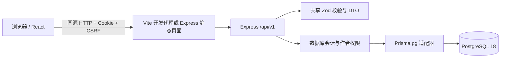

# 当前架构与边界

基线：7fe970d。当前仅实现首周账号、资料和讨论。

- apps/web：路由、表单、远程缓存与响应式 UI。认证状态来自服务端，讨论不保存在 localStorage。
- apps/server：真实 HTTP 服务、Argon2id、摘要会话、CSRF、Origin、限速、公开/私有 DTO 和作者写入校验。
- packages/contracts：共享字段、稳定 DTO 与错误形状。构建服务端时打包本地契约，第三方依赖由锁文件安装。
- prisma：实际 SQL 迁移与幂等 seed。只有 DEMO 模式创建虚构账号和讨论。
- tests/e2e：对构建产物启动独立 3101 服务，使用 campus_test；不使用静态数组模拟账号和帖子。

数据库当前表：School、User、Profile、Session、Topic、Post。关系、邮箱唯一、主题唯一、外键与列表索引实际落库。队伍/岗位/聊天等表不预先堆空实现，进入后续阶段再随迁移和测试加入。

登录先获取匿名 CSRF 上下文；成功后撤销旧上下文并轮换随机 Session Cookie。数据库只存 token/CSRF 摘要，CSRF 使用服务端密钥和当前会话生成，页面刷新可重新获取。所有写入验证 Origin 与令牌；公开资料不返回邮箱、密码摘要或会话。

作者编辑和软删除使用 revision 做条件更新，过期版本返回 409，避免无声覆盖。列表使用 createdAt + UUID 稳定游标。正文始终作为 React 文本渲染，不执行 HTML。

后续团队、消息、AI 与管理必须依照 DECISIONS.md 的事务和权限边界实现，不能复制当前原型中的模拟申请逻辑到正式应用。
