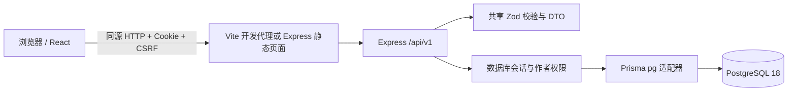

# 当前架构与边界

应用基线：`d426491`。当前实现首周账号、资料、讨论与 W1-S1 最小竞赛招募发布；第 3 天补充账号事务、会话隔离与 W1-04 UI 复核，完整入队 / 聊天 / AI 仍待开发。

- apps/web：路由、表单、远程缓存与响应式 UI。认证状态来自服务端，讨论不保存在 localStorage。
- apps/server：真实 HTTP 服务、Argon2id、摘要会话、CSRF、Origin、限速、公开/私有 DTO 和作者写入校验。
- packages/contracts：共享字段、稳定 DTO 与错误形状。构建服务端时打包本地契约，第三方依赖由锁文件安装。
- prisma：实际 SQL 迁移与幂等 seed。只有 DEMO 模式创建虚构账号和讨论。
- tests/e2e：对构建产物启动独立 3101 服务，使用 campus_test；不使用静态数组模拟账号和帖子。

数据库基础表：School、User、Profile、Session、Topic、Post。10 月 16 日增量迁移新增 Recruitment、Team、TeamSlot、TeamMember、ChatSpace、DomainEvent，支持真实招募发布；ChatSpace 仅为空间关联元数据，没有消息表或收发服务。迁移无重置语句，保留原账号与讨论。

登录先获取匿名 CSRF 上下文；成功后撤销旧上下文并轮换随机 Session Cookie。数据库只存 token/CSRF 摘要，CSRF 使用服务端密钥和当前会话生成，页面刷新可重新获取。所有写入验证 Origin 与令牌；公开资料不返回邮箱、密码摘要或会话。

10 月 17 日修正：注册的用户、资料与 Session 放进同一事务；旧上下文撤销也在其中，事务提交后才发 Cookie。登录轮换 / 注销以有效且未撤销的旧会话做条件更新，争用失败不覆盖 Cookie。密码哈希在事务外计算，减少持锁时间。

浏览器为账号相关请求记录当前身份和会话版本，CSRF 更新重试保留该上下文；服务端用 X-Session-User 对照实际 Cookie，拒绝旧表单被误写成另一个账号。会话版本变化后，旧请求即使成功返回，也不再更新当前认证状态。BroadcastChannel 只传递无凭据的状态变更，接收页丢弃旧缓存 / 表单并等待用户重新加载；通知不可用时服务端身份核对仍起作用。登录态读取失败与真正匿名分开呈现。

作者编辑和软删除使用 revision 做条件更新，过期版本返回 409，避免无声覆盖。列表使用 createdAt + UUID 稳定游标。正文始终作为 React 文本渲染，不执行 HTML。

W1-04 前端补充：讨论卡片记录路由 key、滚动位置与卡片 ID，详情返回时恢复焦点但不重新滚动；内存最多保留最近 100 个已记录位置。详情加载后聚焦标题，Esc 先取消删除确认，再执行返回。搜索输入跟随 URL 查询更新，四区键盘切换仍复用现有选择 / 查询逻辑，没有建立另一份内容状态。辅助尺寸直接复用原设计变量，不引入新组件库或第三方资源。

后续团队、消息、AI 与管理必须依照 DECISIONS.md 的事务和权限边界实现，不能复制当前原型中的模拟申请逻辑到正式应用。

## 竞赛招募发布事务

作者先保存私有 Recruitment（DRAFT），结构化草稿放 JSON，列表所需标题 / 学校 / 主题单独索引。发布前共享 Schema 校验完整字段、岗位合计和队长岗位，服务端重查引用及截止是否晚于当前时间。

发布以 Recruitment 行锁串行化，并在一个事务内创建 Team → TeamSlot → TeamMember(CAPTAIN) → ChatSpace → TEAM_CREATED 事件，再更新招募为 PUBLISHED。唯一 recruitmentId 防止一份招募创建两队，作者 + requestKey 防止草稿重试重复创建，revision 拒绝过时修改。跨队岗位通过复合外键拒绝，部分唯一索引限制每队一个有效队长。岗位合计与占位由发布校验和事务保证；后续加入不能绕过同一队伍锁自行写成员。

事务中后续操作失败，队伍、岗位、成员和前置写入整体回滚。发布响应丢失时，客户端保留已保存草稿和预览，再次 publish 返回既有队伍；并发幂等和回滚均有真实数据库测试。来源讨论软删除不影响已发布招募的独立内容。

目前没有成员变更、队伍调度、通知投递或 Socket；创建事件只为后续演进保留事实，不冒称已实现通知。已发布内容只读，其他三区、直接入队和完整生命周期在相应阶段补齐。
