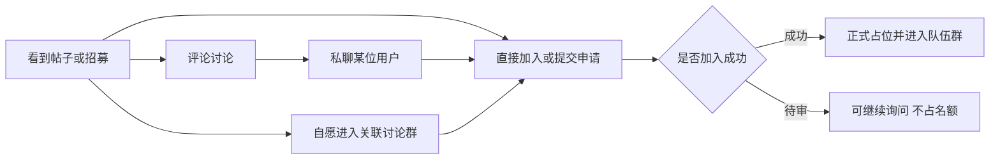

# 碰个头｜招募与社交消息改进详情书

**审阅稿 v1.0 · 2026年11月3日**

适用：游戏、学习、竞赛、户外四区；手机优先，兼顾桌面端。

本次交付为产品方案，供负责人审阅；文中的“建议”“默认”均未成为已批准需求。本轮未修改业务代码、数据库和原项目基线。

> 核心建议：让用户能够先表达、先交流，再按需要确认加入。发布像发帖一样轻，招募状态和正式名额仍然清楚可靠。

## 1. 先看最值得改的六件事

| 改动 | 用户看到的变化 | 解决的问题 |
|---|---|---|
| 四区统一轻发布 | 写想法，选择时间和招募人数，即可预览发布；其他条件按需展开 | 一开始必须把所有安排想清楚，容易放弃 |
| 条件分层 | “必须满足”与“最好具备”分开；未填技能不直接拒绝交流 | 系统替队长过早筛人 |
| 评论直达私聊 | 评论旁有“私聊”；点头像也能找到入口，并可携带原评论 | 看到了合适的人，却无法顺畅联系 |
| 帖子关联讨论群 | 作者可挂群，用户确认后进入；不自动报名 | 同一话题反复在评论中来回沟通 |
| 消息成为会话入口 | 进入消息默认看到私聊和群聊；互动与招募通知另有入口 | 会话、评论通知、申请结果混在一起 |
| 聊天优先的群界面 | 顶部群名、中间消息、底部输入；公告收成一条，队伍管理在侧页 | 进群后先看到说明和管理表单，聊天不突出 |

建议先完成“轻发布＋加入简化＋评论私聊＋统一消息＋群聊界面”。帖子讨论群随后接入，避免一次引入过多群类型和权限。

## 2. 现状判断：哪些是代码事实，哪些是设计判断

本方案阅读了当前工作区源码和项目文档。没有把旧项目书当作全部现状，也没有运行本轮真人可用性测试。以下使用成本是基于交互路径的判断，实际影响需要试用验证。

| 当前可核实行为 | 设计判断 | 建议方向 |
|---|---|---|
| 四区发布均校验主题、标题、说明、目标、协作说明及起止时间；说明至少20字 | 对临时游戏、自习邀约过重；凑字数不能保证有效信息 | 必填只服务于本次场景；允许未定事项明确展示 |
| 竞赛要求比赛名、项目方向、截止日期、岗位总额与队长岗位等 | 适合成熟队伍，不适合“想找人先聊方向” | 增加探索状态，岗位细分可稍后完成 |
| 已有直接加入与审核加入，默认审核；并非完全没有快速加入 | 当前“直接加入”仍承担多项前置确认，体验偏长 | 界面缩短、服务端保留校验 |
| 加入表单先手动核对条件，评估为PASS后才允许提交 | 缺资料也会变成操作阻碍 | 能自动检查的自动检查，软偏好允许继续 |
| 撤回/拒绝后显示10分钟冷却；已退出成员不能重入原队 | 对误操作、临时离开不友好 | 区分主动退出、移除、拒绝和滥用 |
| 评论支持回复、删除、举报，没有私聊入口 | 评论中发现的人无法自然转成会话 | 用户卡和评论动作增加私聊 |
| `/messages` 当前路由为通知页；队伍和群聊另有路由 | 用户期待的聊天收件箱尚未形成 | 将消息首页改为真实会话列表 |
| 队伍聊天已有持久化、幂等与历史补取；前端每2秒轮询 | 基础可靠性已有，实时体验与页面结构可继续改善 | 保留保存机制，增加实时事件与更直观界面 |
| 群聊页面含公告编辑、同步、未读操作和聊天消息；已读需手动标记 | 管理信息占据注意力，阅读反馈不自然 | 聊天主视图与群资料分离，按可见内容更新已读 |

核对入口：`packages/contracts/src/recruitments.ts`、`apps/web/src/components/ApplicationPanel.tsx`、`apps/web/src/components/Community.tsx`、`apps/web/src/App.tsx`、`apps/web/src/pages/Notifications.tsx`、`apps/web/src/pages/TeamChat.tsx`。这些是阅读时的状态，不代表完成了运行验收。

## 3. 主流产品有哪些值得借鉴

研究口径：参考公开官方资料，检索于2026年11月3日；不是逐款登录实测。入口可能随地区、账号与版本变化。TikTok与国内抖音分开处理，不将二者功能直接等同。

| 产品/参照 | 能确认的参考点 | 对碰个头的启发 |
|---|---|---|
| Instagram | 官方介绍会话置顶、已读设置、消息编辑等功能 [官方资料](https://about.fb.com/news/2024/03/instagram-dm-updates/) | 让重要会话容易找、让用户控制阅读反馈；高级编辑后置 |
| Instagram | 官方介绍消息置顶及可更新的群邀请二维码 [官方资料](https://about.fb.com/news/2025/02/new-instagram-dm-features-stay-connected/) | 重要安排固定可见；群入口可分享、可失效 |
| Threads | 官方说明私聊/群聊、消息请求与接收控制 [官方资料](https://about.fb.com/news/2025/07/introducing-messaging-highlighted-perspectives-threads/) | 公开交流可延伸到私下沟通，同时给接收方选择权 |
| 国内抖音 | 官方隐私政策说明私信接收范围、在线状态和通知管理 [官方资料](https://www.douyin.com/draft/douyin_agreement/douyin_agreement_privacy.html?id=6773901168964798477) | 联系方便与接收可控应同时成立 |
| 国内抖音开放平台 | 官方介绍私信、群聊能力 [官方资料](https://developer.open-douyin.com/docs/resource/zh-CN/mini-app/develop/tutorial/open-capabilities/management/private-domain/private-and-group-message) | 内容与交流可以衔接；开放平台能力不能当作消费端每个按钮的证据 |
| 百度贴吧 | 官方协议包含评论及吧群聊消息 [官方资料](https://tieba.baidu.com/tb/eula.html)；“从评论找人交流”也是本次用户提出的参照 | 保留围绕话题认识人的路径；本文的具体评论私聊按钮是本项目建议，并非已核实的贴吧当前全量界面 |

由这些资料与本项目场景推导出的方向：**内容提供认识人的契机，会话保留沟通上下文，招募完成正式协作确认。**这是本方案的综合判断，不是对竞品效果的统计结论。

不用把音乐贴纸、火花连续打卡、短视频沉浸流作为本轮重点。它们能增加互动形式，却不直接解决“发不出招募、找不到群、联系不上人”。

## 4. 产品结构：三个动作要各自清楚

用户应始终能分辨：正在表达兴趣、正在聊天，还是已经正式加入。

| 对象 | 解决什么事 | 人数含义 | 用户动作 |
|---|---|---|---|
| 帖子 | 讨论、分享、认识同好 | 评论数和互动数 | 评论、回复、私聊、进入关联群 |
| 招募 | 明确找人做什么 | 正式成员数/总名额，另列待审人数 | 加入、申请、询问、撤回 |
| 会话 | 私下沟通与持续协作 | 会话参与人数 | 发消息、回复、查看群资料 |

“感兴趣”“收藏”“进讨论群”都不等于正式报名。正式加入需要明确按钮和成功反馈。私聊可以在未入队时建立；队伍群仍只供正式成员使用。



## 5. 四区招募发布：一页主表单，必要时补充

### 5.1 发布主流程

进入“发布”后选择“发帖子 / 找搭子”，记住上次选择。从具体板块或主题进入时带入上下文；不自动替用户确认学校范围、时间或承诺。

找搭子主页面保留五组信息：

1. **做什么**：标题或一句话想法，正文可选；无需重复写目标。
2. **什么时候**：今晚、明天、周末、选日期、时间待商量；精确时间在需要时展开。
3. **再找几位**：默认1位，清楚显示“你＋1位，共2人”。
4. **在哪/怎么参加**：线上或线下；线下填大致区域，具体集合点放群内。
5. **怎么加入**：直接加入或我来确认；用短解释说明两者区别。

主题从当前上下文继承；无上下文时使用快速选择。“更多要求”承载岗位、技能、频次、预算、装备等，按板块出现。表单持续显示当前必须补充的内容，错误紧靠字段。

用户可随时展开预览；简单招募可直接点“发布”，不强制进入独立的二次预览页面。发布前同屏可看到时间、人数、地点和加入方式摘要。发布成功给出“查看招募”“分享给朋友”“进入队伍群”。

### 5.2 四区最小信息与默认策略

以下为建议默认，不代表每个场景都适合直接加入。作者可以调整，页面说明调整带来的影响。

| 板块 | 最小需要表达的信息 | 时间规则 | 建议加入方式 | 更多要求 |
|---|---|---|---|---|
| 游戏 | 游戏/主题、玩法或目标、再找人数 | 可今晚/时间待商量；确定场次再填具体时间 | 休闲局直接加入；排位/固定队可审核 | 服务器、平台、语音、段位偏好 |
| 学习 | 学科或目标、线上/线下、再找人数 | 单次/长期可选；长期招募可先协商 | 普通自习直接加入；教学协作可审核 | 安静自习/讲题、水平、频次、资料 |
| 竞赛 | 比赛名或探索方向、再找人数、当前目标 | 探索期可待定；明确赛事期限应填写或标注未确认 | 默认审核 | 岗位、能力证据、每周投入、赛事链接 |
| 户外 | 活动、日期、大致区域、人数、强度、费用口径 | 正式活动需要明确日期；仅征集想法时标“筹划中” | 默认审核，可对低强度普通活动开放直接加入 | 预算范围、装备、经验、时长、雨天方案 |

服务器/平台只在影响共同游戏时作为必要条件；学习方式只有作者明确要求时才限制；竞赛“有某技能更好”不能默认变成系统硬拦截；户外“费用待确认”不得伪装成免费。

### 5.3 时间与人数怎样简化而不失真

- **时间待商量**：可以发布探索招募，不生成虚构开始/结束时间；卡片明确标识。确认入队前展示“时间尚未确定”，用户主动同意这一点。
- **长期招募**：区分招募有效期和实际协作安排，不强制把长期学习压成一次活动。
- **防止旧帖长期占位**：待定招募建议7天提醒确认，持续不确认可转为暂停；具体期限是待审默认。不会将超期自动显示为“已完成”。
- **人数**：用户填“还想找几位”，系统换算总容量。竞赛只有启用细分岗位时才显示岗位名额；探索期可用“待协商成员”岗位。
- **条件偏好**：允许空白或“可商量”，不要求用户为通过校验填入无意义内容。

### 5.4 一句话输入与模板

示例：“周六下午图书馆复习高数，再找2个人，先一起做题。”系统可提取为可编辑草稿；日期歧义需确认。普通快捷选项必须独立可用。AI只补助理解，不自动发布、不编造空缺、不替用户报名。

提供“今晚开黑”“一起自习”“找竞赛队友”“周末走走”四个模板；用户只改差异项。从旧招募复制时清空过期日期并提醒核对人数，禁止无提示照搬。

## 6. 加入流程：系统做检查，用户只做决定

### 6.1 先区分三种条件

| 条件类型 | 示例 | 处理 |
|---|---|---|
| 系统必要条件 | 账号有效、队伍开放、剩余名额、指定学校范围 | 服务端校验；不满足时解释原因，不能用聊天绕过 |
| 活动必要条件 | 同服务器、指定平台、必要装备、明确时间承诺 | 只对相关活动显示简短确认；作者必须明确标为必要 |
| 偏好与待了解信息 | 技能标签、作品经历、学习水平、语音偏好 | 可提示、可询问；缺失不一律禁止申请 |

“未知”继续如实显示。区别在于未知信息是否真的阻止这次加入：软偏好未知可申请；必要装备未知需本人确认；账号被封禁不能继续。竞赛技能自述应允许补充说明或作品，不只接受标签命中。

### 6.2 直接加入

目标路径：**点“加入”→看必要确认的小面板→成功后进入队伍群。**

面板只显示本次关键安排、人数和必要确认；资料中已有信息自动带入并可改。单一“成员”岗位由系统选定；不要求用户选择只有一个选项的下拉框。取消独立“核对条件”按钮，提交时完成检查；加入结果以服务端为准。

关键反馈：“已加入，目前3/4人。去群里打个招呼。”最后名额被抢先占用时：“刚刚满员了，你还没有加入。可以先联系发起人。”绝不先显示成功，再回滚成员身份。

### 6.3 审核加入

目标路径：**点“申请加入”→选岗位（确实有多个时）＋一句可选介绍→提交。**

时间承诺、必要条件仍按需确认。成功页显示“待发起人确认，不占名额”，提供撤回、私聊询问和回到内容。队长在申请通知或管理面板直接看资料摘要与批准/婉拒操作；批准前复核容量和必要条件。

建议待审超过24小时给队长一次汇总提醒；申请者可取消，不自动批准，不显示虚构响应时间。可选“常在线时段”由作者自填。

### 6.4 退出、重入、候补

| 情况 | 建议规则 |
|---|---|
| 误撤回申请 | 可重新发起；同一待审申请只保留一份；对高频重复行为单独限速 |
| 主动退出队伍 | 招募仍开放时可重新申请；直接加入队也可要求重新确认；不承诺保留原名额 |
| 被队长移除 | 默认不能自助重入；只有负责人明确解除限制后再允许申请 |
| 明确拒绝后反复申请 | 保留合理冷却或由队长允许再次申请；不统一取消反骚扰措施 |
| 队伍满员 | 显示已满；可询问。候补作为后续增强，补位前再次确认，不静默拉人占位 |

## 7. 评论区进入私聊：就地联系，带着话题走

### 7.1 两个入口都要有

- 评论动作行：**回复 · 私聊 · 更多**。自己的评论不显示私聊自己；举报和删除进入更多菜单。
- 点作者头像/昵称：打开轻量用户卡，显示昵称、学校自述、个人简介和“私聊”；以后需要时再扩展关注。

头像操作应使用稳定用户ID，不能用评论ID当作身份来源。用户卡不展示手机号、微信号或未公开资料。

### 7.2 从评论进入私聊的具体流程

1. 点评论旁“私聊”，打开与该用户的会话；已有会话直接复用。
2. 输入框上方显示可移除的引用卡：“来自《周末一起复习》：我也想参加”。
3. 用户写消息并主动发送，才建立实际联系；打开聊天不自动发送招呼。
4. 对方看到来源，点卡片可回到有权限查看的原帖与评论。
5. 发送前校验原内容可见性；原内容已删除/隐藏则不发送失效摘录。历史引用按源状态隐藏正文，保留“原内容已不可用”。

可提供不自动发送的开场建议：“你好，看到你也在准备这场比赛，想聊聊组队。”首条请求中携带来源的目的，是减少对方猜测，而不是替用户套话。

### 7.3 私信接收规则

建议成年校园用户默认允许消息请求。已有互相接受会话、同队成员可直接交流；其他人首次发送进入“新联系人”，显示一条文本和来源。接收方可以接受、忽略、拒绝、拉黑或举报。尚未接受前不允许连续刷屏、发附件或群邀请轰炸。

不强制先互关或添加好友。设置提供“允许消息请求 / 仅已有联系 / 不接收新联系”；同校自述不是可信认证，不应据此无限放开私信。

新联系人入口在消息首页可见，首次真实请求可提示一次；不把正常询问藏到很深的设置页，也不让陌生请求反复触发强提醒。

## 8. 评论区进入群聊：让入口好找，也让加入有含义

### 8.1 推荐两类群，分阶段上线

| 群类型 | 谁可以加入 | 与招募名额的关系 | 展示名称 |
|---|---|---|---|
| 队伍群 | 正式有效成员 | 入队才获得权限，退出即撤销 | “竞赛队伍群 · 3/4名成员” |
| 帖子讨论群 | 作者开启并关联；用户主动确认加入，可设置审核 | 进群不占正式名额 | “帖子讨论群 · 12人，正式报名另行确认” |

第一阶段先做好评论私聊和现有队伍群入口；第二阶段再支持帖子讨论群。普通兴趣群、多人自由建群可放到后续，先不让三四种群入口同时竞争。

### 8.2 关联群如何出现

帖子正文下方和评论顶部显示同一张关联群卡；两个位置指向同一对象，不创建重复群。小屏可以在评论区保留紧凑入口，正文位置显示摘要。

若是讨论群：按钮“进群聊聊”，确认面板显示群名、用途、人数与加入方式。若是队伍群：未加入者看到“加入队伍后可进群”，主操作仍为加入/申请；有效成员看到“打开队伍群”。

作者可在自己评论中插入关联群卡，普通用户分享其他群必须满足分享权限。分享邀请是卡片，不是一串无法辨认的群号。群卡可见不等于群历史可见。

### 8.3 邀请、历史和生命周期

- 点击群卡先预览，不自动加入，不自动占位。
- 邀请链接可撤销、有有效期；每次打开重新检查群状态和权限。
- 用户在私聊中收到群邀请后主动接受；不允许因发过评论就被强行拉群。
- 帖子讨论群新成员默认只看入群后的消息；公开置顶说明可在加入前展示。队伍群可继承现有历史可见规则，但加入前明确告知，并提供给群主选择的空间。
- 作者删帖或招募结束不应无提示地让会话消失。按群类型显示失效、只读或待归档状态；群与帖子的关闭策略分别确定。
- 讨论群进入正式队伍时，用户仍需明确申请/加入。两类群不复制聊天记录，避免将原本小范围内容扩散。

## 9. 消息中心：把聊天放回第一页

### 9.1 页面结构

保留底部五项导航：发现、招募、发布、消息、我的。先不新增第六项“群聊”。

消息页顶部采用三个一级标签：**聊天 / 互动 / 通知**。聊天内部用“全部 / 私聊 / 群聊”筛选，另有清晰的“新联系人”入口。这样既能单独找群，也不把首页变成过多分页。

- 聊天：真实的一对一会话和已加入的群，会话预览含头像、名称、类型、最后消息、时间和未读。
- 互动：评论、回复、点赞、@我。点击后定位具体内容并保留返回位置。
- 通知：申请、批准、移除、招募状态和系统事项。重要通知中的按钮直接办理对应事务。

默认按最近有效活动排序，支持置顶、搜索、免打扰。已归档会话折叠到“已归档”；用户主动删除列表项只是隐藏自己的入口，不替对方删除历史，也不等于退群。

### 9.2 未读、提醒与接收

| 场景 | 行为建议 |
|---|---|
| 正在前台看当前聊天 | 更新可见消息的已读位置，不再弹当前会话提醒 |
| 用户正在翻旧消息 | 不强行拉到底；出现“有3条新消息”按钮 |
| 群免打扰 | 普通群消息只在会话内标记；@我可按用户设置提醒 |
| 收到多条点赞 | 合并为一项互动，不连续刷弹窗 |
| 申请已批准 | 一条持久通知加明确“去队伍群”；已读后不因刷新重弹 |
| 多设备阅读 | 已读位置只前进；服务端按会话同步，不因旧设备覆盖而倒退 |
| 陌生人连续发送 | 请求未接受前限制追加；提供拒绝与拉黑 |

底部“消息”数字建议只累计未静音的聊天未读与待处理重要事项；普通互动用小点，二级标签展示各自数量，避免同一事件重复计数。最终口径应在开发前统一，不混用“消息条数”和“会话数”。

网页后台、关闭标签页时的通知依赖浏览器权限与推送能力。第一阶段承诺站内与重新打开后的可靠补取；系统推送作为独立增强，不能仅靠轮询宣称“退出网页也能即时收到”。

## 10. 群聊界面：先聊天，再管理

### 10.1 手机端示意

下面是结构草图，不是已实现页面；示例人物与内容均为虚构。

```text
┌──────────────────────────────┐
│ ‹  高数复习队（3人）       ⋯  │
│ 队伍群 · 周六14:00 · 正式3/4人│
├──────────────────────────────┤
│ 📌 集合安排：图书馆二楼   展开│
├──────────────────────────────┤
│          今天 13:20           │
│ 小林  我带了往年题，大家需要吗│
│                              │
│                 需要，谢谢！ │
│                              │
│ 小陈  [回复：我带了往年题…]   │
│       我负责整理错题          │
│                              │
│       有3条新消息 ↓           │
├──────────────────────────────┤
│ ＋  输入消息…          发送   │
└──────────────────────────────┘
```

草图符号仅表达位置；正式界面用统一图标。公告默认一行，空公告不占大块区域。群名点击打开群资料；“⋯”提供搜索、免打扰、举报、退出等，不把管理表单常驻聊天区。

### 10.2 群资料与协作

群资料包含成员、公告、关联帖子/招募、加入方式、分享与管理。队长可从这里进入申请审核和队伍设置。普通成员不显示无权操作的表单。

队伍群可在顶部显示活动摘要：“周六14:00 · 还差1人”。点击进入安排详情，聊天区只保留关键状态。普通讨论群不显示正式队伍占位数。

桌面端使用“会话列表＋聊天＋可收起的群资料”布局；小屏进聊天后以会话为主要视图，返回恢复原列表滚动位置。输入框随软键盘保持可见，长消息与多图不撑破页面。

### 10.3 消息发送与可靠性

第一阶段做好文本、明确发送状态、失败重试、引用回复、未读定位；第二阶段增加图片、表情反应、搜索和消息置顶。语音、文件、通话不与核心路径一起挤入。

消息状态采用：**发送中 → 已发送**；确实失败时显示失败与重试，超时但结果未知时显示“正在确认发送结果”。重试复用同一消息标识，避免出现两条。

已发送代表服务器已保存，不等于对方已接收或已读。对方已读需要真实阅读回执；允许关闭对外展示。群聊不默认展开每个人的已读名单。

新增实时事件用于提示新消息，HTTP和数据库继续负责可靠保存与补取；实时连接断开后有退避重连与轮询兜底。输入状态和在线状态属于后续，可设置关闭；不能因页面后台或轮询推测用户正在看消息。

## 11. 关键页面变化一览

| 页面 | 首屏重点 | 主要操作 | 需要避免 |
|---|---|---|---|
| 招募大厅 | 事项、时间、缺几位、地点、加入方式 | 看详情/快速加入 | 一张卡塞满所有条件 |
| 发布招募 | 一句话、时间、人数、参加方式 | 发布/保存草稿 | 强制每项都写成长段说明 |
| 招募详情 | 先回答做什么、何时、还有位吗 | 加入/申请＋私聊询问 | 同时展示多个同等强度按钮 |
| 帖子详情 | 正文、讨论、关联招募/群 | 评论、联系、参与 | 仅靠隐藏手势找私聊 |
| 评论区 | 回复关系与评论者身份 | 回复、私聊、更多 | 将评论者直接拉进群 |
| 消息首页 | 最近聊天和待处理事项 | 打开会话、找群、处理请求 | 通知压过聊天 |
| 群聊天页 | 消息和输入 | 发消息、回复、查看资料 | 公告编辑和技术说明占据首屏 |
| 我的 | 我的招募、申请、队伍记录 | 管理与回溯 | 成为查找群聊的唯一入口 |

### 11.1 招募详情底部按钮随状态变化

| 用户/招募状态 | 主按钮 | 次操作 |
|---|---|---|
| 开放且可直接加入 | 加入 | 私聊询问 |
| 开放且需审核 | 申请加入 | 私聊询问 |
| 已提交申请 | 等待确认 | 修改说明/撤回/私聊 |
| 有效成员 | 打开队伍群 | 查看队伍 |
| 满员 | 已满员 | 联系发起人；后续可候补 |
| 暂停、结束或取消 | 显示实际状态 | 看公开内容；联系入口按双方设置 |
| 本人发布 | 管理招募 | 打开队伍群 |

未登录者可以看公开内容；在私聊、加入等动作发生时登录，成功后回到原目标并保留可恢复的输入，不让用户重新找帖。

## 12. 视觉与交互：延续品牌，减少操作干扰

保留现有“碰个头”的纸色、黑黄主色、四区辨识与原创人物。聊天页面采用更稳定的布局：文字、头像、输入框优先，装饰让出阅读区域。

- 消息不再每次轮询都播放明显入场；只有真实新增消息有轻微反馈。
- 发布和加入时，点击立刻有按压或加载反馈，成功反馈必须等待真实结果。
- 新增会话和群类型同时使用文字标识，不只靠颜色区分。
- 保留正常系统光标；聊天输入与长文本阅读场景建议弱化鼠标跟随装饰。
- 关键按钮触达区域建议至少44×44 CSS像素；正文建议16像素起，保证中文可读性。
- 支持键盘、可见焦点、屏幕阅读标签；动画尊重减少动态效果偏好。
- 中文输入法组合输入时，Enter不能误发消息；桌面允许设置Enter发送、Shift+Enter换行，手机保留明确发送按钮。
- 页面返回恢复评论位置和输入；抽屉关闭后焦点回到触发按钮。


## 13. 必须一起想清楚的边界

这里的限制直接服务于新增私聊、群聊功能，避免简单化之后出现新的使用问题。

| 边界 | 推荐处理 |
|---|---|
| 只想先问问题 | 允许私聊，不强迫报名；对方可通过请求设置控制接收 |
| 进入讨论群却以为报名成功 | 群入口和入群成功页都显示“不占报名名额” |
| 同一人从多条评论联系 | 同一对用户复用一对一会话，引用作为不同消息上下文 |
| 同一帖子关联多个招募 | 每张卡显示对应活动；不默认猜测私聊者想加入哪一支 |
| 退出/移除后继续接收 | 立即撤销相应群的读取与实时订阅权限；已显示内容无法承诺从用户记忆或截图中收回 |
| 拉黑后仍在同一队 | 私聊联系被阻断；群内行为单独解释与管理，不将拉黑等同移除成员 |
| 精确地点被陌生人看到 | 公开只展示大致区域，群内安排按成员权限读取 |
| 时间/地点发生较大变更 | 通知正式成员，必要时请求重新确认；不静默改变已作出的承诺 |
| 活动结束仍想继续联系 | 原队伍群按原政策归档；后续可自愿另建讨论群，不自动迁移成员或历史 |
| 历史招募缺少新字段 | 按旧规则展示和运行，编辑时提示升级；不自动降低已有硬条件 |

## 14. 实施建议：先做完整闭环，再扩展群玩法

### 14.1 分期与依赖

| 阶段 | 范围 | 交付结果 |
|---|---|---|
| A：招募减负 | 四区轻发布、软硬条件、自动核对、单岗位自动选择、成功直达队伍群 | 四区都能以更短路径完成发布与加入 |
| B：社交主链路 | 一对一私聊、消息请求、评论引用、消息会话首页、现有队伍群界面重排 | 从评论找到人，真实发送、接收、返回；群聊容易找 |
| C：关联讨论群 | 帖子挂群、入群确认、邀请卡、群资料、单独群成员权限 | 不占队伍名额也能自愿讨论 |
| D：协作增强 | 图片、回复、搜索、置顶、候补、活动提醒、推送评估 | 高频使用时更方便 |

队伍群入口和聊天布局可在A/B内并行推进，但发布校验、入队规则和会话权限不能拆成只做外观的交付。这里不填写未经开发评估的固定工期。

### 14.2 开发涉及什么

供后续评估使用，不要求用户审阅时决定字段名。

- **招募契约**：支持时间待定、单次/长期、偏好与必要条件；不同状态分开校验，不能只是把后端必填统一删掉。
- **加入逻辑**：界面取消手动预检后，服务端仍在事务内校验岗位和容量；审批请求复核实时事实。
- **会话模型**：需要与队伍解耦的会话、参与者与角色、私信请求状态、来源引用、每用户已读位置。现有队伍聊天可以迁移适配，不能直接假定字段足够。
- **身份与权限**：评论返回稳定作者标识；私聊关系、群成员、正式队伍成员各自负责对应权限。
- **消息收发**：复用幂等保存与补取思路，增加实时事件、个人会话列表、撤权订阅处理；新联系人请求与普通未读分开。
- **兼容与交付**：现有队伍不强制重建；旧群链接可重定向；新功能分开开关；迁移前备份并验证，最后同步项目书、接口和验收用例。

旧基线把私信列为后续，并规定正式入队后才能读队伍群。这次建议把私聊提升为当前社交改进重点，同时用独立讨论群承接入队前交流。审阅通过后应显式更新这些规则，避免前后端各按不同版本实现。

## 15. 怎样判断改动真的有用

以下均为建议验收目标和测试设计，不是现有结果或市场数据。

### 15.1 可用性试用

建议找8—12名未参与开发的同学，四区均有覆盖，分别执行旧版和新版任务；交替测试顺序，减少学习效应。记录成功与失败、耗时、求助次数和用户原话，不用“感觉好看”替代流程证据。

| 任务 | 期望观察 |
|---|---|
| 游戏：发今晚休闲局，找2人 | 不需要填无关协作目标；能解释最终总人数 |
| 学习：发长期复习，时间待商量 | 能发布，明确未定事项，不被迫编造日期 |
| 竞赛：找会前端的人，技能可商量 | 区分偏好与必要条件；资料不全者可说明情况申请 |
| 户外：发周六低强度步行 | 日期、区域、强度和费用清楚；没有过度公开具体集合点 |
| 从评论联系某人 | 无指导发现私聊入口；对方知道为何被联系 |
| 从帖子进讨论群再申请组队 | 能解释当前是否正式报名、是否占位 |
| 从消息重新找到队伍群 | 不必先进入个人中心或招募详情 |

初始目标：简单招募中位发布用时较旧版减少30%；无障碍的直接加入在详情后最多一个确认面板；多数试用者能在10秒内找到群聊；消息中不会把“已保存”误认成“对方已读”。样本小，只用于发现问题，不外推整体用户结论。

### 15.2 必须验收的正确性

1. 四区各完成一次发布、直接加入/审核加入、私聊和回到原内容。
2. 两人争最后一个名额，只一人成为成员，失败者不获得群权限。
3. 同一消息超时重试不重复；断线恢复补齐；无权限会话不能补取。
4. 原帖隐藏或评论删除后，引用卡不会继续暴露已撤回正文。
5. 请求未接受、拒绝、拉黑、解除拉黑的发送能力与界面一致。
6. 成员退出、移除和封禁后，HTTP与实时事件同时撤权。
7. 讨论群成员不能因入群获得正式队伍资料、名额或队伍群历史。
8. 正在翻旧消息、中文输入法、软键盘、长群名和窄屏下聊天仍可用。
9. 刷新、后台恢复、多端阅读不产生重复提醒或已读倒退。
10. 旧招募、旧队伍、旧链接和只读归档保持可解释、可访问的行为。

## 16. 供你过目的决策清单

建议先讨论这些产品选择，再决定视觉细节；每项都可以单独保留、调整或暂缓。

| 编号 | 要决定的事 | 本稿推荐 | 需要权衡 |
|---|---|---|---|
| D01 | 游戏/学习是否默认直接加入 | 普通场景默认直接，作者可改 | 更快；作者管理频率可能增加 |
| D02 | 是否允许时间待定 | 游戏、学习、竞赛探索期允许；户外正式活动明确日期 | 更容易发起；要标明未定并处理过期招募 |
| D03 | 技能不足是否允许申请 | 软偏好允许，明确必要条件单独确认 | 机会更多；队长需读说明 |
| D04 | 私聊是否必须先加好友 | 不需要；陌生联系进入请求 | 路径短；需要清晰的接收控制 |
| D05 | 评论旁是否直接出现私聊 | 出现，同时保留头像用户卡入口 | 易发现；评论动作要保持简洁 |
| D06 | 能否先进入群再报名 | 可进独立讨论群，队伍群仍需正式入队 | 更灵活；多一个需要解释的群类型 |
| D07 | 是否先开放所有用户自由建群 | 暂缓，先完成私聊与关联讨论群 | 聚焦核心流程；自由社交稍后扩展 |
| D08 | 退出后能否重入 | 主动退出可重新申请；被移除需解除限制 | 减少误操作成本；保留群主管理权 |
| D09 | 是否立刻做语音/视频 | 后置，先做好文字与图片 | 稳住主流程；丰富表达稍后补 |
| D10 | 群消息已读是否默认公开到个人 | 不默认公开；私聊可设置 | 压力更小；协作反馈较少 |

## 17. 还可以继续改进什么

下面这些值得进入下一轮观察，不建议同时塞入首期。

- **先有同伴再定活动**：在探索型招募中共同确认时间，而不要求发起人独自确定全部安排。
- **轻量投票**：群里确定时间、地点与活动方式，投票结束生成清楚的安排卡；用户确认后更新招募，不悄悄改动。
- **申请可修改**：修改岗位和介绍时保留同一申请轨迹，避免撤回再来一遍。
- **队长批量处理**：同岗位申请集中比较，批准仍逐个校验，不用一次性“全通过”造成超员。
- **有限提醒**：报名截止、活动开始、关键变更可订阅；普通聊天与活动提醒分开控制。
- **完成后继续联系**：自愿保留联系人或建立长期讨论群；不强迫用户为了聊天维持一支已结束队伍。
- **搜索更贴近目的**：按“今晚、有位置、接受新手、线上、同校”找招募；按人名、群名找会话，消息内容搜索另开范围。
- **更可靠的个人资料**：以用户主动提供的作品或经历帮助队长判断，不用无法证实的匹配分代替人际判断。

## 18. 参考资料

以下来源支撑第3节中的具体功能参考；正文的发布规则、权限设计、默认值和实施排序是针对碰个头提出的建议。公开资料不等于本项目已接入相应能力。

- **[S1]** Meta，2024-03-04：[Edit Your Messages, Pin Your Chats and More Instagram DM Updates](https://about.fb.com/news/2024/03/instagram-dm-updates/)。
- **[S2]** Meta，2025-02-19：[New Instagram DM Features to Help You Stay Connected](https://about.fb.com/news/2025/02/new-instagram-dm-features-stay-connected/)。
- **[S3]** Meta，2025-07-01发布、页面含后续更新：[Introducing Messaging and Highlighted Perspectives on Threads](https://about.fb.com/news/2025/07/introducing-messaging-highlighted-perspectives-threads/)。
- **[S4]** 抖音：[“抖音”隐私政策](https://www.douyin.com/draft/douyin_agreement/douyin_agreement_privacy.html?id=6773901168964798477)，参照设置管理、私信和通知相关说明。
- **[S5]** 抖音开放平台：[小程序私信、群聊能力概述](https://developer.open-douyin.com/docs/resource/zh-CN/mini-app/develop/tutorial/open-capabilities/management/private-domain/private-and-group-message)，仅作官方能力方向参考。
- **[S6]** 百度贴吧：[客户端百度贴吧协议](https://tieba.baidu.com/tb/eula.html)，用于确认评论与吧群聊的内容形态，不作为具体入口路径的证明。

本地依据：`docs/PROJECT_SPEC.md`、`docs/DECISIONS.md`、`docs/PROGRESS.md`、`docs/INTERACTION_REVIEW_2026-10-30.md`及第2节列出的源码文件。
